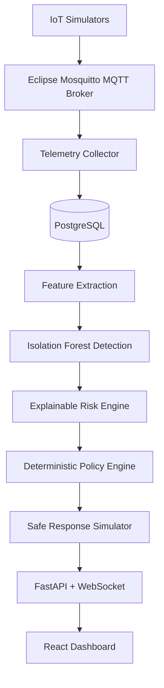

# AI Adaptive IoT Defense Platform

Hardware-free defensive IoT cybersecurity MVP for portfolio and research demos. The platform simulates IoT devices, collects MQTT telemetry, extracts behavior features, trains an Isolation Forest baseline, calculates explainable risk, applies a deterministic policy engine, and simulates quarantine/recovery inside an isolated Docker network.

This project is defensive and educational. It does not scan, attack, contact, or modify external systems.

## Architecture



## Stack

Python 3.12+, FastAPI, SQLAlchemy 2, Alembic, PostgreSQL, Eclipse Mosquitto, Paho MQTT, Pandas, scikit-learn, React, TypeScript, Vite, Docker Compose, Pytest, Ruff, and mypy.

## Quick Start

```bash
make setup
make disk-check
make compose-config
docker compose up -d postgres mosquitto
make migrate
make up
make demo
```

URLs:

- API: `http://localhost:8000`
- OpenAPI: `http://localhost:8000/docs`
- Dashboard: `http://localhost:5173`

## Documentation

- [Demo Guide](docs/demo-guide.md): setup, startup order, migrations, demo data, safe simulations, shutdown, and troubleshooting.
- [API Guide](docs/api-guide.md): system endpoints, read-only resources, admin endpoints, and API-key behavior.
- [Architecture](docs/architecture.md): service boundaries and container roles.
- [Data Flow](docs/data-flow.md): telemetry ingestion through response/audit records.
- [Threat Model](docs/threat-model.md): defensive scope and security assumptions.
- [ML Evaluation](docs/ml-evaluation.md): preliminary metric definitions and limitations.
- [Contributing](CONTRIBUTING.md): local workflow, checks, and security reporting.

## Admin Authentication

Sensitive simulation and manual override endpoints require:

```text
X-Admin-API-Key: <ADMIN_API_KEY from .env>
```

Swagger UI exposes this through the **Authorize** button. Keep the demo key local and replace it before sharing the environment.

## Demo Flow

Startup order is database first, then Alembic migration, then application services and demo data:

```bash
docker compose up -d postgres mosquitto
make migrate
docker compose up -d
make demo
```

`make demo` seeds simulated normal traffic, creates feature windows, trains the Isolation Forest model, runs a preliminary evaluation script, and leaves audit/risk/action records for the dashboard.

Safe attack traffic can be published inside the Docker network:

```bash
docker compose run --rm api python /workspace/scripts/demo_safe_attack.py mqtt_flood --device-id camera-01 --intensity 40
docker compose run --rm api python /workspace/scripts/demo_safe_attack.py auth_failures --device-id lock-01
docker compose run --rm api python /workspace/scripts/demo_safe_attack.py unauthorized_topic --device-id camera-01
docker compose run --rm api python /workspace/scripts/demo_safe_attack.py unknown_destination --device-id camera-01
```

## Risk Formula

Risk is deterministic and capped at 100:

- ML anomaly score: up to 35
- Traffic spike: up to 20
- Failed authentication: up to 15
- Unknown destination: up to 20
- Unauthorized topic: up to 15
- Repeated recent anomalies: up to 15

Levels:

- 0-29: normal
- 30-59: suspicious
- 60-79: high
- 80-100: critical

Every assessment stores reason contributions that add up to the final score.

## Policy Behavior

ML output never directly executes a response. The deterministic policy engine selects only allow-listed simulated actions:

`monitor`, `increase_monitoring`, `create_alert`, `rate_limit_simulated`, `temporary_quarantine`, `schedule_health_check`, `restore_access`, `retain_quarantine`.

Default policy:

- 0-29: monitor
- 30-59: create alert and increase monitoring
- 60-79: create alert and simulated rate limiting
- 80-100 with 3 consecutive high-risk assessments: temporary quarantine

Quarantine is simulated at the application/MQTT-processing layer. No host firewall rules are changed.

## Commands

```bash
make setup
make up
make migrate
make migration-check
make train
make test
make lint
make git-safety
make disk-check
make frontend-build
make demo
make smoke
make verify
make down
```

`make down` stops containers without deleting the PostgreSQL volume.

`make clean-db-reset` is destructive. It prompts for confirmation and deletes the local PostgreSQL Docker volume and all demo data.

Backend containers run as a non-root application UID/GID. Make targets create the project `models/` directory as the host user and pass the current host IDs to Docker Compose as `LOCAL_UID=$(id -u)` and `LOCAL_GID=$(id -g)`, so generated model artifacts under the `models/` bind mount remain writable on hosts where the user is not UID 1000. If you build backend images directly, provide those values yourself:

```bash
LOCAL_UID=$(id -u) LOCAL_GID=$(id -g) docker compose build migrate api collector simulator
```

## Git Safety

Run the staged-file safety check before committing:

```bash
make git-safety
git diff --cached --check
```

To install the optional versioned pre-commit hook for this repository:

```bash
git config core.hooksPath scripts/hooks
```

To disable the hook:

```bash
git config --unset core.hooksPath
```

The hook runs `scripts/git_safety_check.py` and `git diff --cached --check`. It is local Git protection only; configure GitHub branch protection after pushing the repository.

## Disk Safety

Docker builds, especially `docker compose build --no-cache`, can consume several GiB of temporary and cached storage. Keep at least 8 GiB free on both the project filesystem and Docker data filesystem before Docker-heavy verification.

Run the non-destructive preflight:

```bash
make disk-check
```

The checker uses Python `shutil.disk_usage`, reports total/used/free space and percentage, fails below 5 GiB free, warns from 5 GiB to under 8 GiB, and passes at 8 GiB or more. It does not delete anything. `scripts/foundation_runtime_verify.py` runs this preflight before Docker clean/build/runtime work.

For diagnostics only:

```bash
make disk-usage
```

This may print `df -h`, `docker system df`, and project directory size summaries. It does not prune or delete anything.

Manual cleanup candidates, when you choose to run them yourself:

- `docker system df`: shows Docker image, container, volume, and build-cache usage.
- `docker builder prune`: deletes unused Docker build cache only.
- `docker image prune`: deletes dangling untagged Docker images only.
- `docker system prune`: deletes stopped containers, unused networks, dangling images, and build cache; it does not delete volumes unless `--volumes` is added.
- `docker volume prune`: deletes all unused local Docker volumes, including database volumes from other projects if they are unused.

## Dashboard Troubleshooting

If the dashboard is blank or unavailable:

```bash
docker compose ps
docker compose logs dashboard --tail=200
curl -i http://localhost:5173
curl -i http://localhost:8000/health
curl -i http://localhost:8000/ready
```

The dashboard is built with `VITE_API_URL=http://localhost:8000` so the host browser calls the host-exposed API port, not the internal Docker service name. It now renders a visible shell, empty state, timeout/error state, and retry action even when the API or database is unavailable.

After changing frontend environment values, rebuild the dashboard image:

```bash
docker compose build dashboard
docker compose up -d dashboard
```

## Verification

Use the non-destructive verification workflow first:

```bash
make verify
```

It runs Compose config validation, backend/simulator tests, frontend tests, Ruff, mypy, TypeScript checks, and a production frontend build. If a Docker stack is already running and reachable, it also runs the migration head check and the E2E smoke test.

Runtime verification on a Docker-enabled shell:

```bash
LOCAL_UID=$(id -u) LOCAL_GID=$(id -g) docker compose build
docker compose up -d postgres mosquitto
make migrate
make migrate
docker compose up -d
make demo
make demo
make migration-check
make smoke
docker compose ps
```

Clean database verification deletes local demo data and must be explicit:

```bash
make clean-db-reset
LOCAL_UID=$(id -u) LOCAL_GID=$(id -g) docker compose build --no-cache
docker compose up -d postgres mosquitto
make migrate
make migrate
```

Useful logs:

```bash
docker compose logs postgres --tail=200
docker compose logs mosquitto --tail=200
docker compose logs migrate --tail=200
docker compose logs api --tail=200
docker compose logs collector --tail=200
docker compose logs simulator --tail=200
docker compose logs dashboard --tail=200
```

## Troubleshooting

| Symptom | Likely cause | Diagnostic command | Safe resolution |
| --- | --- | --- | --- |
| Docker commands return permission denied | Current user cannot access Docker daemon | `docker compose ps` | Run from a Docker-enabled shell or fix local Docker group/session access |
| `DuplicateObject: type "devicestatus" already exists` | Old image/migration or partial schema state | `docker compose logs migrate --tail=200` | Rebuild API image; only use `make clean-db-reset` after confirming demo data deletion |
| API starts before tables exist | Migration service did not complete | `docker compose ps -a` | Run `make migrate`; inspect `migrate` logs |
| Dashboard is blank | API unavailable, stale dashboard image, or static asset failure | `curl -i http://localhost:5173` and dashboard logs | Rebuild dashboard and verify `VITE_API_URL=http://localhost:8000` |
| `make demo` repeats data unexpectedly | Seed marker missing or database reset | `docker compose run --rm api python /workspace/scripts/seed_demo_data.py` | Re-run `make demo`; output reports created/updated/skipped |

## Dependency Advisories

`npm audit` currently reports Vite/esbuild-related advisories through the dev-server/test toolchain. The suggested remediation requires `npm audit fix --force` and a breaking Vite major upgrade, so it is intentionally not applied in this foundation hardening pass. Production dashboard assets are built and served with `vite preview`; do not expose the Vite dev server beyond local demo use.

## Metrics

`scripts/evaluate_model.py` reports preliminary precision, recall, F1, and false-positive rate from a small reproducible demo set. These are not production-quality claims.

Prepared metrics:

- Precision, recall, F1
- False-positive rate
- Detection latency
- Response latency
- Quarantine accuracy
- Recovery success rate
- Simulated service downtime

## Known Limitations

- This is a simulated lab, not real device control.
- API-key auth is suitable only for local demos.
- The model baseline depends on generated simulator data.
- WebSocket currently provides connectivity/heartbeat; dashboard state refreshes through REST polling.
- Metrics are preliminary unless a larger labeled dataset is generated.

## Roadmap

- Richer labeled evaluation datasets.
- More detailed dashboard charts.
- Persistent attack-control state.
- Stronger local auth and role separation.
- Real hardware adapter research mode, kept disabled by default.

## Screenshots

Add dashboard screenshots here after running `make up` and `make demo`.

## Portfolio Value

This MVP demonstrates backend architecture, ML inference boundaries, DevSecOps-safe containerization, explainable security decisions, auditability, and defensive IoT research constraints.

## License

MIT License. See [LICENSE](LICENSE).
