# Architecture

The MVP is split into isolated logical components:

```mermaid
flowchart LR
  Sim[Device Simulators] --> MQTT[Mosquitto]
  MQTT --> Collector[Telemetry Collector]
  Collector --> DB[(PostgreSQL)]
  DB --> Features[Feature Windows]
  Features --> ML[Isolation Forest]
  ML --> Risk[Risk Engine]
  Risk --> Policy[Policy Engine]
  Policy --> Response[Safe Response Simulator]
  Response --> API[FastAPI]
  API --> UI[React Dashboard]
```

The key safety boundary is between ML output and response execution. ML emits only an anomaly score. Risk and policy modules deterministically validate whether any response is appropriate.

## Containers

- `postgres`: internal database.
- `mosquitto`: internal MQTT broker.
- `api`: FastAPI service.
- `collector`: MQTT subscriber and pipeline runner.
- `simulator`: normal IoT telemetry generator.
- `dashboard`: Vite development dashboard.

No container uses host networking, privileged mode, or Docker socket mounts.
